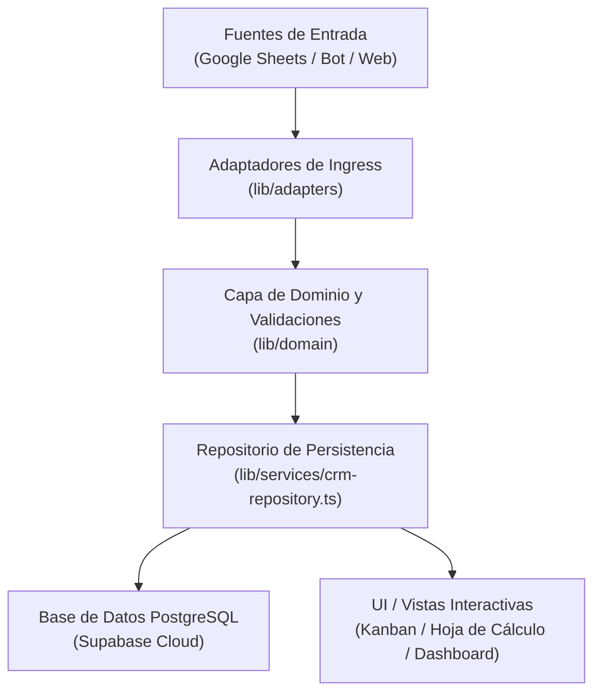

# 📘 Guía Maestra: Administración, Modificación y Código de Campuslands CRM

Esta guía contiene toda la información técnica y operativa para que puedas **administrar, personalizar y modificar este CRM desde tu casa** o en cualquier computadora, ya sea desde la propia interfaz web sin programar o editando el código fuente en tu editor favorito.

---

## 📑 Tabla de Contenidos
1. [Arquitectura General y Componentes](#1-arquitectura-general-y-componentes)
2. [Cómo Modificar las Etapas del Embudo a tu Antojo](#2-c%C3%B3mo-modificar-las-etapas-del-embudo-a-tu-antojo)
3. [Cómo Modificar Productos, Orígenes y Filtros](#3-c%C3%B3mo-modificar-productos-or%C3%ADgenes-y-filtros)
4. [Cómo Trabajar y Correr el Proyecto en tu Casa (Paso a Paso)](#4-c%C3%B3mo-trabajar-y-correr-el-proyecto-en-tu-casa-paso-a-paso)
5. [Estructura de la Base de Datos en Supabase](#5-estructura-de-la-base-de-datos-en-supabase)
6. [Cómo Sincronizar, Importar y Exportar con Google Sheets](#6-c%C3%B3mo-sincronizar-importar-y-exportar-con-google-sheets)
7. [Despliegue y Actualizaciones en Vercel](#7-despliegue-y-actualizaciones-en-vercel)

---

## 1. Arquitectura General y Componentes

El proyecto fue diseñado bajo un patrón **Monolito Modular con Adaptadores Hexagonales**:



### ¿Dónde está cada archivo en el repositorio?
* `app/page.tsx`: Pantalla principal del CRM (orquesta el menú lateral, filtros, pestañas por etapa, Kanban y vistas).
* `lib/types.ts`: Define todas las entidades (`Lead`, `Payment`, `Stage`, `Priority`, `Agreement`).
* `lib/sales-playbook.ts`: Catálogo de programas de Campuslands, cotizador GTQ en cuotas, matriz de objeciones y guiones de WhatsApp.
* `features/leads/components/kanban-board.tsx`: Tablero Kanban arrastrable de prospectos.
* `features/leads/components/lead-table.tsx`: Vista interactiva estilo hoja de cálculo de Google Sheets.
* `features/leads/components/lead-forms.tsx`: Ficha de detalle del prospecto y formulario de nuevo lead.
* `features/stages/components/stage-customizer-modal.tsx`: Modal para editar etapas desde la web.
* `features/sheets/components/sheets-sync-modal.tsx`: Centro de importación y exportación de Sheets y CSV.

---

## 2. Cómo Modificar las Etapas del Embudo a tu Antojo

Tienes **dos formas** de cambiar las etapas:

### Opción A: Desde la Web (Sin programar)
1. Abre tu CRM en [https://campuslands-crm-ashen.vercel.app](https://campuslands-crm-ashen.vercel.app).
2. Ve a la sección **Embudo de Admisiones**.
3. En la barra de herramientas, haz clic en el botón **⚙️ Personalizar Etapas**.
4. Se abrirá una ventana donde puedes:
   * **Editar el nombre:** Haz clic en el texto de cualquier etapa y escribe el nuevo nombre.
   * **Cambiar el color:** Haz clic en el selector de color al lado de la etapa.
   * **Reordenar:** Usa las flechas ⬆️ o ⬇️ para mover una etapa de posición.
   * **Agregar nueva etapa:** Escribe el nombre en el recuadro inferior y presiona `+ Agregar`.
   * **Eliminar:** Usa el icono del basurero 🗑️ en la etapa que no quieras.
5. Haz clic en **Guardar cambios**. ¡El Kanban y las pestañas se actualizarán al instante!

---

### Opción B: Desde el Código (Si programas en casa)
Si quieres que las etapas por defecto del código cambien de forma permanente:

1. Abre el archivo `lib/types.ts`.
2. Busca la constante `STAGES`:
   ```typescript
   export const STAGES: { id: Stage; label: string; color: string; bg: string }[] = [
     { id: "nuevo", label: "Nuevo lead", color: "#3b82f6", bg: "#eff6ff" },
     { id: "en_conversacion", label: "En conversacion bot/asesor", color: "#f59e0b", bg: "#fef3c7" },
     { id: "interesado", label: "Interesado", color: "#059669", bg: "#d1fae5" },
     { id: "ya_se_llamo", label: "Ya se llamó", color: "#16a34a", bg: "#dcfce7" },
     { id: "confirmado", label: "confirmado", color: "#0d9488", bg: "#ccfbf1" },
     { id: "inscrito_forms", label: "Inscrito en forms", color: "#7c3aed", bg: "#ede9fe" },
     { id: "no_interesado", label: "no interesado", color: "#6b7280", bg: "#f3f4f6" },
   ];
   ```
3. Puedes cambiar cualquier `label`, `color` o agregar nuevos objetos.

---

## 3. Cómo Modificar Productos, Orígenes y Filtros

En `lib/types.ts` se encuentran centralizadas las listas desplegables que alimentan los filtros y formularios:

### 1. Productos
```typescript
export const PRODUCTS = [
  "CODE UP",
  "MARKETING IA",
  "AGENTES IA",
  "FINANZAS IA",
  "ANALISIS IA",
] as const;
```

### 2. Canales de Origen
```typescript
export const ORIGINS = [
  "BOT",
  "Facebook",
  "Instagram",
  "KHC",
  "OTRO",
] as const;
```

### 3. Prioridades
```typescript
export const PRIORITIES = [
  { id: "URGENTE", label: "URGENTE", color: "#dc2626", bg: "#fee2e2" },
  { id: "SEGUIMIENTO", label: "SEGUIMIENTO", color: "#16a34a", bg: "#dcfce7" },
  { id: "INDESCISO", label: "INDESCISO", color: "#9333ea", bg: "#f3e8ff" },
  { id: "OCUPADO", label: "OCUPADO", color: "#2563eb", bg: "#dbeafe" },
  { id: "NO CONTESTA", label: "NO CONTESTA", color: "#ef4444", bg: "#fee2e2" },
  { id: "colgo", label: "colgo", color: "#6b7280", bg: "#f3f4f6" },
  { id: "No califica", label: "No califica", color: "#374151", bg: "#e5e7eb" },
];
```

### 4. Acuerdos y Gestión de Pago
```typescript
export const AGREEMENTS = ["CONCRETADO", "EN PROCESO", "INCONCRETO"] as const;

export const PAYMENT_STATUSES = [
  "Pagado",
  "pendiente de pago",
  "No pago, no finalizo proceso",
  "Cupo Gratis",
] as const;
```

Si agregas o cambias una opción aquí, automáticamente se reflejará en la tabla, el Kanban y los filtros.

---

## 4. Cómo Trabajar y Correr el Proyecto en tu Casa (Paso a Paso)

Para abrir, editar y probar el CRM en tu computadora personal:

### Paso 1: Instalar herramientas básicas
* **Node.js (versión 20 o superior):** Descárgalo en [nodejs.org](https://nodejs.org/).
* **Git:** Descárgalo en [git-scm.com](https://git-scm.com/).
* **VS Code:** Descárgalo en [code.visualstudio.com](https://code.visualstudio.com/).

### Paso 2: Clonar el repositorio
Abre una terminal (PowerShell o Git Bash) y escribe:
```bash
git clone https://github.com/barriosevelyn488-web/proyecto_ia_academy.git
cd proyecto_ia_academy
```

### Paso 3: Instalar dependencias
```bash
npm install
```

### Paso 4: Configurar variables de entorno locales
Crea un archivo llamado `.env.local` en la raíz del proyecto y pega tus credenciales de Supabase:
```ini
NEXT_PUBLIC_SUPABASE_URL=https://feovctmibfliduztonfw.supabase.co
NEXT_PUBLIC_SUPABASE_ANON_KEY=eyJhbGciOiJIUzI1NiIsInR5cCI6IkpXVCJ9...
```

### Paso 5: Iniciar el servidor local
```bash
npm run dev
```
Abre tu navegador en: **`http://localhost:3000`**. Verás el CRM funcionando exactamente igual que en internet.

### Paso 6: Guardar y subir cambios a producción
Cuando hagas una mejora en los archivos:
```bash
git add .
git commit -m "mi mejora o cambio de etapas"
git push origin main
```
Al hacer `git push`, Vercel detecta el cambio y actualiza tu sitio web en vivo automáticamente.

---

## 5. Estructura de la Base de Datos en Supabase

Tu proyecto en Supabase se llama `campuslands-crm` (ID: `feovctmibfliduztonfw`).

### Tablas Principales:
* **`public.leads`**: Almacena todos los prospectos.
  * `id`: Identificador único (UUID).
  * `full_name`: Nombre completo.
  * `phone`: Teléfono en formato internacional (`+502...`).
  * `email`: Correo electrónico.
  * `origin`: Origen (BOT, Facebook, Instagram, etc.).
  * `product`: Producto (CODE UP, etc.).
  * `stage`: Etapa del flujo de cierre.
  * `priority`: Prioridad (`URGENTE`, `SEGUIMIENTO`, etc.).
  * `agreement`: Acuerdo (`CONCRETADO`, `EN PROCESO`, etc.).
  * `payment_status`: Estado de pago (`Pagado`, etc.).
  * `deal_amount`: Monto acordado en GTQ.
  * `notes`: Comentarios u observaciones.
  * `nit`: NIT para facturación.
  * `source_key`: Clave única para evitar duplicados (`telefono:producto`).
* **`public.payments`**: Registro de pagos recibidos, cuotas y referencias.
* **`public.lead_activities`**: Bitácora de WhatsApp abierto, notas y llamadas.
* **`public.organizations`**: Soporte multi-tenant para Campuslands y configuración de equipo.

---

## 6. Cómo Sincronizar, Importar y Exportar con Google Sheets

### Importación Rápida (Copiar y Pegar):
1. Abre tu hoja de cálculo (ej. pestaña *Seguimiento!*).
2. Selecciona las filas que quieres traer y presiona `Ctrl + C`.
3. En el CRM, haz clic en **Importar / Exportar ➔ Pegar desde Sheets**.
4. Presiona `Ctrl + V`.
5. El sistema lee las 12 columnas automáticamente:
   * Columna 1: Fecha
   * Columna 2: Número (WhatsApp)
   * Columna 3: Nombre
   * Columna 4: Origen
   * Columna 5: Producto
   * Columna 6: Estado (Flujo de cierre)
   * Columna 7: Prioridad
   * Columna 8: Acuerdo
   * Columna 9: Gestión de pago
   * Columna 10: NIT
   * Columna 11: Monto
   * Columna 12: Comentario
6. Revisa la vista previa y haz clic en **Importar contactos al CRM**.

---

## 7. Despliegue y Actualizaciones en Vercel

* **URL oficial:** `https://campuslands-crm-ashen.vercel.app`
* **Si una actualización tarda en verse en tu navegador:**
  1. Presiona `Ctrl + F5` en el navegador para forzar la recarga sin caché.
  2. En el panel de Vercel ([vercel.com](https://vercel.com/dashboard)): entra al proyecto `campuslands-crm` ➔ pestaña **Deployments** ➔ haz clic en los 3 puntos del último despliegue y selecciona **Redeploy**.
